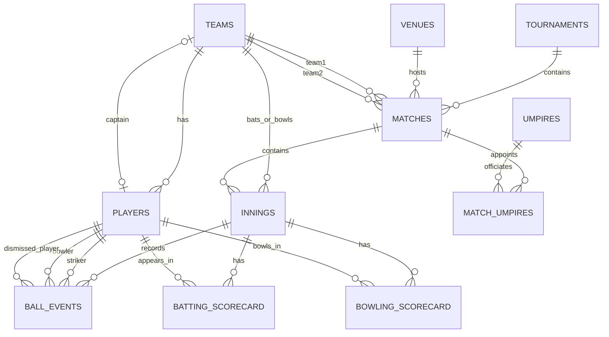

# Live Cricket Score Tracker — Complete Project Blueprint

## 1. Project Overview

**Project:** Live Cricket Score Tracker  
**Database:** MySQL 8.0+  
**Frontend:** Next.js (App Router), React, TypeScript, Tailwind CSS  
**Backend/API:** Next.js Route Handlers (`app/api/...`) using `mysql2/promise`  
**Live updates:** Server-Sent Events (SSE) for scoreboards, with polling as a simple fallback  
**Purpose:** Record every delivery, maintain accurate innings and player statistics, display live scoreboards, and query historical match performance.

This blueprint is based on the uploaded DBMS abstract. It preserves its eleven core tables:

1. `teams`
2. `players`
3. `venues`
4. `tournaments`
5. `matches`
6. `umpires`
7. `match_umpires`
8. `innings`
9. `ball_events`
10. `batting_scorecard`
11. `bowling_scorecard`

The abstract calls for match scheduling, innings-wise scorecards, delivery recording (including wides and no-balls), results, strike rates, leading run-scorers and wicket-takers, 3NF, constraints, transactions, and controlled concurrent access.

### Important implementation decisions

- **A delivery is the source of truth.** Store every delivery in `ball_events`; derive score totals and overs from those events. This avoids relying on a manually edited total.
- **Legal balls are not the same as deliveries.** Wides and no-balls normally do not count as legal balls; byes and leg-byes usually do. Store this explicitly.
- **Use a transaction for each scoring action.** Insert the delivery and update any cached scorecard/innings values atomically, or roll everything back.
- **Never connect the browser directly to MySQL.** The browser calls Next.js API endpoints; only server-side code uses database credentials.
- **Live update mechanism:** SSE is a good fit when the server only needs to push score changes to viewers. Use polling for a simpler first version. WebSockets are an option if the app needs frequent two-way live interaction.
- **Do not trust client-submitted totals.** The server validates the active innings, batting/bowling teams, batter, bowler, extras, and wicket rules.

---

## 2. System Architecture

```text
Browser (Next.js + React + Tailwind)
        |
        | HTTPS: fetch() / React Server Components
        v
Next.js Route Handlers (API + validation + authorization)
        |
        | mysql2/promise, parameterized SQL
        v
MySQL 8.0+
  ├── Master data: teams, players, venues, tournaments, umpires
  ├── Fixtures and officials: matches, match_umpires
  ├── Match state: innings
  ├── Event log: ball_events
  └── Player figures: batting_scorecard, bowling_scorecard
        |
        v
SSE / polling sends the refreshed scoreboard to viewers
```

### Request flow for one ball

1. The scorer chooses the striker, non-striker, bowler, runs, extras and dismissal details.
2. React submits a `POST /api/innings/:inningId/balls` request.
3. The API validates the request and checks that the match/innings is live.
4. A MySQL transaction locks the innings row, calculates the next delivery position and validates the event.
5. The transaction inserts `ball_events` and updates the cached innings and scorecard totals.
6. The transaction commits. If any step fails, it rolls back.
7. The API returns the accepted delivery and current score snapshot.
8. The UI updates immediately from the response; other viewers receive the change through SSE or polling.

---

## 3. Recommended Folder Structure

```text
cricket-tracker/
├── app/
│   ├── layout.tsx
│   ├── page.tsx                       # Home / live matches
│   ├── matches/
│   │   ├── page.tsx                   # Fixtures and results
│   │   └── [matchId]/
│   │       ├── page.tsx               # Match centre / scoreboard
│   │       └── scorecard/page.tsx
│   ├── admin/
│   │   ├── teams/page.tsx
│   │   ├── players/page.tsx
│   │   ├── tournaments/page.tsx
│   │   ├── venues/page.tsx
│   │   └── matches/page.tsx
│   └── api/
│       ├── matches/route.ts
│       ├── matches/[matchId]/route.ts
│       ├── matches/[matchId]/scoreboard/route.ts
│       ├── innings/[inningId]/balls/route.ts
│       ├── balls/[ballId]/route.ts
│       ├── matches/[matchId]/start/route.ts
│       └── matches/[matchId]/events/route.ts  # SSE, where hosting supports it
├── components/
│   ├── MatchCard.tsx
│   ├── LiveScoreboard.tsx
│   ├── InningsTabs.tsx
│   ├── BattingScorecard.tsx
│   ├── BowlingScorecard.tsx
│   ├── BallEntryPanel.tsx
│   ├── BallByBallTimeline.tsx
│   └── AdminForm.tsx
├── lib/
│   ├── db.ts                          # MySQL connection pool
│   ├── validation.ts                  # Zod schemas / validation
│   ├── cricket-rules.ts               # Legal-ball, extras, wicket rules
│   ├── score-service.ts               # Transactional scoring logic
│   └── queries.ts                     # Read/query helpers
├── types/
│   └── cricket.ts
├── .env.local                         # Never commit this file
├── .env.example
├── package.json
└── README.md
```

The exact API paths can be adjusted, but keep database operations in server-only modules rather than React components.

---

## 4. Database Design

### 4.1 Conventions

- Use InnoDB and `utf8mb4`.
- Use `INT UNSIGNED AUTO_INCREMENT` primary keys for a straightforward college project.
- Use foreign keys and suitable unique constraints.
- Store timestamps in UTC where possible; display them in the viewer's local time.
- Keep tables normalized. `innings.runs`, `innings.wickets` and scorecard values are cached/derived values maintained by the scoring service; the delivery log remains the source of truth.
- Do not store a formatted over such as `3.4` as a decimal. Store legal balls as an integer and format them as `3.4` in the UI.
- The schema uses a `team_id` on `players`, matching the abstract's one-team-per-player model. If players must move between teams while preserving old team membership, add a `team_squads`/`player_team_history` table in a later version.

### 4.2 MySQL schema (11 core tables)

Run this in MySQL Workbench or the MySQL command line. For an existing database, take a backup before applying a schema.

```sql
CREATE DATABASE IF NOT EXISTS cricket_tracker
  CHARACTER SET utf8mb4 COLLATE utf8mb4_0900_ai_ci;
USE cricket_tracker;

CREATE TABLE tournaments (
  tournament_id INT UNSIGNED AUTO_INCREMENT PRIMARY KEY,
  name VARCHAR(120) NOT NULL,
  format ENUM('T20', 'ODI', 'TEST', 'OTHER') NOT NULL DEFAULT 'T20',
  start_date DATE NOT NULL,
  end_date DATE NULL,
  CHECK (end_date IS NULL OR end_date >= start_date)
) ENGINE=InnoDB;

CREATE TABLE venues (
  venue_id INT UNSIGNED AUTO_INCREMENT PRIMARY KEY,
  name VARCHAR(120) NOT NULL,
  city VARCHAR(100) NOT NULL,
  seating_capacity INT UNSIGNED NULL,
  UNIQUE KEY uq_venue_name_city (name, city)
) ENGINE=InnoDB;

CREATE TABLE teams (
  team_id INT UNSIGNED AUTO_INCREMENT PRIMARY KEY,
  name VARCHAR(100) NOT NULL UNIQUE,
  city VARCHAR(100) NULL,
  captain_id INT UNSIGNED NULL,
  created_at TIMESTAMP NOT NULL DEFAULT CURRENT_TIMESTAMP
) ENGINE=InnoDB;

CREATE TABLE players (
  player_id INT UNSIGNED AUTO_INCREMENT PRIMARY KEY,
  name VARCHAR(120) NOT NULL,
  role ENUM('BATTER', 'BOWLER', 'ALL_ROUNDER', 'WICKET_KEEPER') NOT NULL,
  batting_style ENUM('RIGHT_HAND', 'LEFT_HAND', 'UNKNOWN') NOT NULL DEFAULT 'UNKNOWN',
  bowling_style VARCHAR(80) NULL,
  team_id INT UNSIGNED NOT NULL,
  is_active BOOLEAN NOT NULL DEFAULT TRUE,
  CONSTRAINT fk_players_team
    FOREIGN KEY (team_id) REFERENCES teams(team_id)
    ON UPDATE CASCADE ON DELETE RESTRICT,
  INDEX idx_players_team (team_id),
  INDEX idx_players_name (name)
) ENGINE=InnoDB;

-- Captain is a player, and must belong to the same team.
-- The cross-table same-team rule is validated by the API/service (or a trigger).
ALTER TABLE teams
  ADD CONSTRAINT fk_teams_captain
  FOREIGN KEY (captain_id) REFERENCES players(player_id)
  ON UPDATE CASCADE ON DELETE SET NULL;

CREATE TABLE umpires (
  umpire_id INT UNSIGNED AUTO_INCREMENT PRIMARY KEY,
  name VARCHAR(120) NOT NULL,
  certification_level VARCHAR(80) NULL
) ENGINE=InnoDB;

CREATE TABLE matches (
  match_id INT UNSIGNED AUTO_INCREMENT PRIMARY KEY,
  tournament_id INT UNSIGNED NOT NULL,
  match_date DATETIME NOT NULL,
  toss_winner_team_id INT UNSIGNED NULL,
  toss_decision ENUM('BAT', 'BOWL') NULL,
  toss_result VARCHAR(255) NULL,
  status ENUM('UPCOMING', 'LIVE', 'COMPLETED', 'ABANDONED', 'NO_RESULT') NOT NULL DEFAULT 'UPCOMING',
  team1_id INT UNSIGNED NOT NULL,
  team2_id INT UNSIGNED NOT NULL,
  winner_id INT UNSIGNED NULL,
  result_summary VARCHAR(255) NULL,
  venue_id INT UNSIGNED NOT NULL,
  created_at TIMESTAMP NOT NULL DEFAULT CURRENT_TIMESTAMP,
  updated_at TIMESTAMP NOT NULL DEFAULT CURRENT_TIMESTAMP ON UPDATE CURRENT_TIMESTAMP,
  CONSTRAINT fk_matches_tournament FOREIGN KEY (tournament_id)
    REFERENCES tournaments(tournament_id) ON UPDATE CASCADE ON DELETE RESTRICT,
  CONSTRAINT fk_matches_team1 FOREIGN KEY (team1_id)
    REFERENCES teams(team_id) ON UPDATE CASCADE ON DELETE RESTRICT,
  CONSTRAINT fk_matches_team2 FOREIGN KEY (team2_id)
    REFERENCES teams(team_id) ON UPDATE CASCADE ON DELETE RESTRICT,
  CONSTRAINT fk_matches_winner FOREIGN KEY (winner_id)
    REFERENCES teams(team_id) ON UPDATE CASCADE ON DELETE SET NULL,
  CONSTRAINT fk_matches_toss_winner FOREIGN KEY (toss_winner_team_id)
    REFERENCES teams(team_id) ON UPDATE CASCADE ON DELETE SET NULL,
  CONSTRAINT fk_matches_venue FOREIGN KEY (venue_id)
    REFERENCES venues(venue_id) ON UPDATE CASCADE ON DELETE RESTRICT,
  CONSTRAINT chk_different_teams CHECK (team1_id <> team2_id),
  INDEX idx_matches_status_date (status, match_date),
  INDEX idx_matches_tournament (tournament_id)
) ENGINE=InnoDB;

CREATE TABLE match_umpires (
  match_id INT UNSIGNED NOT NULL,
  umpire_id INT UNSIGNED NOT NULL,
  role ENUM('ON_FIELD_1', 'ON_FIELD_2', 'TV', 'FOURTH', 'REFEREE', 'OTHER') NOT NULL,
  PRIMARY KEY (match_id, umpire_id, role),
  CONSTRAINT fk_match_umpires_match FOREIGN KEY (match_id)
    REFERENCES matches(match_id) ON UPDATE CASCADE ON DELETE CASCADE,
  CONSTRAINT fk_match_umpires_umpire FOREIGN KEY (umpire_id)
    REFERENCES umpires(umpire_id) ON UPDATE CASCADE ON DELETE RESTRICT
) ENGINE=InnoDB;

CREATE TABLE innings (
  inning_id INT UNSIGNED AUTO_INCREMENT PRIMARY KEY,
  match_id INT UNSIGNED NOT NULL,
  inning_no TINYINT UNSIGNED NOT NULL,
  batting_team_id INT UNSIGNED NOT NULL,
  bowling_team_id INT UNSIGNED NOT NULL,
  runs INT UNSIGNED NOT NULL DEFAULT 0,
  wickets TINYINT UNSIGNED NOT NULL DEFAULT 0,
  legal_balls INT UNSIGNED NOT NULL DEFAULT 0,
  target_runs INT UNSIGNED NULL,
  status ENUM('NOT_STARTED', 'LIVE', 'COMPLETED', 'DECLARED', 'ABANDONED') NOT NULL DEFAULT 'NOT_STARTED',
  started_at DATETIME NULL,
  ended_at DATETIME NULL,
  UNIQUE KEY uq_match_inning (match_id, inning_no),
  CONSTRAINT fk_innings_match FOREIGN KEY (match_id)
    REFERENCES matches(match_id) ON UPDATE CASCADE ON DELETE CASCADE,
  CONSTRAINT fk_innings_batting_team FOREIGN KEY (batting_team_id)
    REFERENCES teams(team_id) ON UPDATE CASCADE ON DELETE RESTRICT,
  CONSTRAINT fk_innings_bowling_team FOREIGN KEY (bowling_team_id)
    REFERENCES teams(team_id) ON UPDATE CASCADE ON DELETE RESTRICT,
  CONSTRAINT chk_innings_different_teams CHECK (batting_team_id <> bowling_team_id),
  INDEX idx_innings_match (match_id)
) ENGINE=InnoDB;

CREATE TABLE ball_events (
  ball_id BIGINT UNSIGNED AUTO_INCREMENT PRIMARY KEY,
  inning_id INT UNSIGNED NOT NULL,
  sequence_no INT UNSIGNED NOT NULL,
  over_no SMALLINT UNSIGNED NOT NULL,
  ball_no TINYINT UNSIGNED NOT NULL,
  striker_id INT UNSIGNED NOT NULL,
  non_striker_id INT UNSIGNED NULL,
  bowler_id INT UNSIGNED NOT NULL,
  batter_runs TINYINT UNSIGNED NOT NULL DEFAULT 0,
  extra_runs TINYINT UNSIGNED NOT NULL DEFAULT 0,
  extra_type ENUM('WIDE', 'NO_BALL', 'BYE', 'LEG_BYE', 'PENALTY', 'NONE') NOT NULL DEFAULT 'NONE',
  total_runs TINYINT UNSIGNED NOT NULL DEFAULT 0,
  is_legal_ball BOOLEAN NOT NULL DEFAULT TRUE,
  wicket_fallen BOOLEAN NOT NULL DEFAULT FALSE,
  wicket_type ENUM(
    'BOWLED', 'CAUGHT', 'LBW', 'RUN_OUT', 'STUMPED', 'HIT_WICKET',
    'OBSTRUCTING_FIELD', 'HIT_BALL_TWICE', 'TIMED_OUT', 'RETIRED_OUT', 'OTHER'
  ) NULL,
  dismissed_player_id INT UNSIGNED NULL,
  commentary VARCHAR(500) NULL,
  recorded_by VARCHAR(100) NULL,
  created_at TIMESTAMP NOT NULL DEFAULT CURRENT_TIMESTAMP,
  UNIQUE KEY uq_inning_sequence (inning_id, sequence_no),
  CONSTRAINT fk_ball_events_inning FOREIGN KEY (inning_id)
    REFERENCES innings(inning_id) ON UPDATE CASCADE ON DELETE CASCADE,
  CONSTRAINT fk_ball_striker FOREIGN KEY (striker_id)
    REFERENCES players(player_id) ON UPDATE CASCADE ON DELETE RESTRICT,
  CONSTRAINT fk_ball_non_striker FOREIGN KEY (non_striker_id)
    REFERENCES players(player_id) ON UPDATE CASCADE ON DELETE RESTRICT,
  CONSTRAINT fk_ball_bowler FOREIGN KEY (bowler_id)
    REFERENCES players(player_id) ON UPDATE CASCADE ON DELETE RESTRICT,
  CONSTRAINT fk_ball_dismissed FOREIGN KEY (dismissed_player_id)
    REFERENCES players(player_id) ON UPDATE CASCADE ON DELETE RESTRICT,
  CONSTRAINT chk_ball_runs CHECK (total_runs = batter_runs + extra_runs),
  CONSTRAINT chk_wicket_player CHECK (
    (wicket_fallen = FALSE AND dismissed_player_id IS NULL)
    OR (wicket_fallen = TRUE AND dismissed_player_id IS NOT NULL)
  ),
  INDEX idx_ball_inning_sequence (inning_id, sequence_no),
  INDEX idx_ball_bowler (bowler_id),
  INDEX idx_ball_striker (striker_id)
) ENGINE=InnoDB;

CREATE TABLE batting_scorecard (
  scorecard_id BIGINT UNSIGNED AUTO_INCREMENT PRIMARY KEY,
  inning_id INT UNSIGNED NOT NULL,
  player_id INT UNSIGNED NOT NULL,
  runs INT UNSIGNED NOT NULL DEFAULT 0,
  balls_faced INT UNSIGNED NOT NULL DEFAULT 0,
  fours INT UNSIGNED NOT NULL DEFAULT 0,
  sixes INT UNSIGNED NOT NULL DEFAULT 0,
  is_out BOOLEAN NOT NULL DEFAULT FALSE,
  dismissal_type VARCHAR(40) NULL,
  dismissed_by_player_id INT UNSIGNED NULL,
  strike_rate DECIMAL(7,2) NOT NULL DEFAULT 0.00,
  UNIQUE KEY uq_batting_inning_player (inning_id, player_id),
  CONSTRAINT fk_batting_inning FOREIGN KEY (inning_id)
    REFERENCES innings(inning_id) ON UPDATE CASCADE ON DELETE CASCADE,
  CONSTRAINT fk_batting_player FOREIGN KEY (player_id)
    REFERENCES players(player_id) ON UPDATE CASCADE ON DELETE RESTRICT,
  CONSTRAINT fk_batting_dismissed_by FOREIGN KEY (dismissed_by_player_id)
    REFERENCES players(player_id) ON UPDATE CASCADE ON DELETE SET NULL
) ENGINE=InnoDB;

CREATE TABLE bowling_scorecard (
  scorecard_id BIGINT UNSIGNED AUTO_INCREMENT PRIMARY KEY,
  inning_id INT UNSIGNED NOT NULL,
  player_id INT UNSIGNED NOT NULL,
  legal_balls_bowled INT UNSIGNED NOT NULL DEFAULT 0,
  maidens INT UNSIGNED NOT NULL DEFAULT 0,
  runs_conceded INT UNSIGNED NOT NULL DEFAULT 0,
  wickets INT UNSIGNED NOT NULL DEFAULT 0,
  economy_rate DECIMAL(7,2) NOT NULL DEFAULT 0.00,
  UNIQUE KEY uq_bowling_inning_player (inning_id, player_id),
  CONSTRAINT fk_bowling_inning FOREIGN KEY (inning_id)
    REFERENCES innings(inning_id) ON UPDATE CASCADE ON DELETE CASCADE,
  CONSTRAINT fk_bowling_player FOREIGN KEY (player_id)
    REFERENCES players(player_id) ON UPDATE CASCADE ON DELETE RESTRICT
) ENGINE=InnoDB;
```

### Schema notes and rules

1. **Captain relationship:** the foreign key guarantees that `captain_id` references a real player, but a simple FK cannot guarantee that the player belongs to that same team. Validate this in the API or enforce it with a database trigger.
2. **Innings teams:** validate that batting and bowling teams are the two teams participating in the associated match.
3. **Winner:** only set `winner_id` to one of the match's two teams, and only when a result is determined.
4. **Overs:** store `legal_balls`; render overs using `Math.floor(legalBalls / 6) + "." + (legalBalls % 6)`. Do not use decimal arithmetic for cricket overs.
5. **Ball numbering:** `sequence_no` is the delivery's order, including wides/no-balls. `over_no` and `ball_no` are display coordinates; an illegal delivery may mean more than six deliveries occur in an over. The scoring service should determine these values, not accept them blindly from the browser.
6. **Bowling runs conceded:** batter runs and most no-ball/wide extras are charged to the bowler; byes, leg-byes and penalty runs generally are not. Implement the cricket rules deliberately in one tested service module.
7. **Wickets:** not every wicket is credited to the bowler. Store `wicket_type` so bowling wickets can be calculated according to the applicable rules.
8. **Player-team history:** this initial design follows the abstract and assigns each player to one current team. For historical tournament accuracy across transfers, introduce a team-squad membership table.
9. **Scorecards:** the scorecard tables are maintained projections for fast display. They must be updated in the same transaction as each delivery. A repair/rebuild script should be available to recompute them from `ball_events`.
10. The schema intentionally uses `inning_id` as the scorecard scope. The abstract lists both `match_id` and `inning_id`; because an inning already identifies its match, storing both can introduce redundant data and inconsistency. Join through `innings` to get the match.

---

## 5. Relationships (ER Model)



The `captain` relationship is logically circular because `teams.captain_id` references `players`, while `players.team_id` references `teams`. Create the teams table first, create players, then add the captain foreign key as shown in the SQL.

---

## 6. Ball-by-Ball Scoring Logic

### 6.1 Fields submitted by the scorer

A scoring request should contain only the event details, not a claimed innings total.

```json
{
  "strikerId": 12,
  "nonStrikerId": 13,
  "bowlerId": 7,
  "batterRuns": 4,
  "extraRuns": 0,
  "extraType": "NONE",
  "wicketFallen": false,
  "wicketType": null,
  "dismissedPlayerId": null,
  "commentary": "Driven through cover"
}
```

The server calculates `totalRuns`, legal-ball status, sequence, over/ball labels, and score totals.

### 6.2 Basic scoring rules

- Total team runs for a delivery = `batter_runs + extra_runs`.
- Batter runs increase only by `batter_runs`.
- A wide normally adds at least one extra and is not a legal ball.
- A no-ball normally adds at least one extra and is not a legal ball.
- Byes and leg-byes count as legal balls, unless a specific competition rule says otherwise.
- A legal ball increments `innings.legal_balls` and `bowling_scorecard.legal_balls_bowled`.
- Batter balls faced generally exclude wides and no-balls; implement competition-specific edge cases in the rules service.
- Fours and sixes in the batter's scorecard count batter-hit boundaries, not four/six total team runs from overthrows or extras.
- Increment wickets only for a valid dismissal event; validate the dismissed player and wicket type.
- Rotate strike according to completed runs and over-end rules. This is scorer workflow logic and should be covered by tests.

Cricket laws have edge cases. Treat this list as the MVP rule set and verify the exact rules expected for your competition.

### 6.3 Transaction pattern

The following is a service-level outline, not a drop-in complete scoring engine. Put the complete cricket-rule calculations in tested helper functions.

```ts
const conn = await pool.getConnection();

try {
  await conn.beginTransaction();

  // 1. Lock the innings row so two scorers cannot allocate the same next sequence.
  const [inningsRows] = await conn.execute(
    `SELECT inning_id, match_id, batting_team_id, bowling_team_id,
            runs, wickets, legal_balls, status
       FROM innings
      WHERE inning_id = ?
      FOR UPDATE`,
    [inningId]
  );

  // 2. Validate: inning exists and is LIVE; players belong to the correct teams;
  //    request is valid; match is LIVE; no duplicate client request was accepted.

  // 3. Determine next sequence_no, over_no, ball_no, total_runs and is_legal_ball.
  //    Use the innings lock and a unique constraint to protect sequence allocation.

  // 4. INSERT INTO ball_events (...).
  // 5. Update innings totals and legal_balls.
  // 6. Upsert batting_scorecard and bowling_scorecard values.
  // 7. If the innings/match has ended, update innings.status and matches.status/result.

  await conn.commit();
} catch (error) {
  await conn.rollback();
  throw error;
} finally {
  conn.release();
}
```

### 6.4 Idempotency and corrections

- Generate a unique `requestId` on the client for each scoring submission and store it in a dedicated idempotency table, or add a unique `client_event_id` to `ball_events`. If the browser retries after a timeout, the same event must not be inserted twice.
- Do not silently delete an accepted delivery. For the MVP, restrict corrections to an authorized scorer and perform correction plus scorecard rebuild in a transaction. For stronger auditability, add a `ball_event_corrections` table or store void/replacement events.
- Record who scored the delivery if user accounts are implemented.

---

## 7. MySQL Connection in Next.js

### 7.1 Install dependencies

```bash
npm install mysql2 zod
npm install -D @types/node
```

Create `.env.local`:

```env
DB_HOST=127.0.0.1
DB_PORT=3306
DB_USER=cricket_app
DB_PASSWORD=replace_with_a_strong_password
DB_NAME=cricket_tracker
```

Do not prefix database credentials with `NEXT_PUBLIC_`. Never commit `.env.local`.

Create a dedicated MySQL user with only the permissions the app needs. Avoid using the MySQL root account from the application.

### 7.2 Connection pool (`lib/db.ts`)

```ts
import mysql from "mysql2/promise";

const globalForMySQL = globalThis as unknown as {
  mysqlPool?: mysql.Pool;
};

export const pool =
  globalForMySQL.mysqlPool ??
  mysql.createPool({
    host: process.env.DB_HOST,
    port: Number(process.env.DB_PORT ?? 3306),
    user: process.env.DB_USER,
    password: process.env.DB_PASSWORD,
    database: process.env.DB_NAME,
    waitForConnections: true,
    connectionLimit: 10,
    maxIdle: 10,
    idleTimeout: 60_000,
    queueLimit: 0,
    enableKeepAlive: true,
    timezone: "Z",
  });

if (process.env.NODE_ENV !== "production") {
  globalForMySQL.mysqlPool = pool;
}
```

Use a Node.js runtime for routes that use `mysql2`:

```ts
export const runtime = "nodejs";
```

### 7.3 Example read endpoint

`app/api/matches/route.ts`

```ts
import { NextResponse } from "next/server";
import { pool } from "@/lib/db";

export const runtime = "nodejs";

export async function GET() {
  try {
    const [rows] = await pool.execute(`
      SELECT
        m.match_id AS matchId,
        m.match_date AS matchDate,
        m.status,
        t1.name AS team1,
        t2.name AS team2,
        v.name AS venue,
        v.city AS venueCity
      FROM matches m
      JOIN teams t1 ON t1.team_id = m.team1_id
      JOIN teams t2 ON t2.team_id = m.team2_id
      JOIN venues v ON v.venue_id = m.venue_id
      ORDER BY m.match_date DESC
    `);

    return NextResponse.json({ data: rows });
  } catch {
    return NextResponse.json(
      { error: "Unable to load matches" },
      { status: 500 }
    );
  }
}
```

### 7.4 Example create endpoint

`app/api/matches/route.ts` can also expose `POST`. Validate the body with Zod, authorize the caller, and use a parameterized insert:

```ts
const [result] = await pool.execute(
  `INSERT INTO matches
    (tournament_id, match_date, team1_id, team2_id, venue_id, status)
   VALUES (?, ?, ?, ?, ?, 'UPCOMING')`,
  [tournamentId, matchDate, team1Id, team2Id, venueId]
);
```

Never concatenate user input into SQL. Validate IDs, enum values, date formats, and cross-field rules on the server.

### 7.5 API design

| Method | Endpoint | Purpose |
|---|---|---|
| GET | `/api/matches` | List fixtures, live matches and results |
| POST | `/api/matches` | Create a fixture |
| GET | `/api/matches/:matchId` | Match details |
| PATCH | `/api/matches/:matchId` | Edit permitted match metadata/status |
| POST | `/api/matches/:matchId/start` | Create/start innings and mark match live |
| GET | `/api/matches/:matchId/scoreboard` | Current score, overs, batter/bowler and recent balls |
| GET | `/api/matches/:matchId/scorecard` | Batting and bowling scorecards |
| POST | `/api/innings/:inningId/balls` | Record one delivery |
| POST | `/api/balls/:ballId/correction` | Authorized correction workflow |
| GET | `/api/matches/:matchId/events` | SSE stream for score updates, if supported |

For the mini-project, the endpoints may be consolidated, but keep the responsibilities separated.

---

## 8. Frontend Pages and Components

### 8.1 Home page

- Header with project name and navigation.
- Live matches section with a clear `LIVE` status.
- Upcoming fixtures and completed results.
- Match cards showing team names, venue, start time, and score if available.
- Links to match centre and full scorecard.

### 8.2 Match centre (`/matches/[matchId]`)

- Match title, tournament, venue, date and match status.
- Large score display: `Team A 145/4`.
- Overs formatted from legal balls, e.g. `18.2 overs`.
- Current run rate; required run rate and target when relevant.
- Current striker/non-striker and bowler figures.
- Recent-delivery timeline (for example: `1, 4, W, 0, WD, 2`).
- Innings tabs and a link to the full scorecard.
- Last-updated indicator and connection status.

### 8.3 Scorer panel

This panel should only be accessible to an authorized scorer.

- Select striker, non-striker and bowler from eligible players.
- Buttons for `0`, `1`, `2`, `3`, `4`, `6`, `Wide`, `No-ball`, `Bye`, `Leg-bye`, and wicket.
- For wickets, select wicket type and dismissed player.
- Optional commentary.
- Undo/correction action with confirmation and audit record.
- Disable controls while a request is being submitted.
- On API failure, show an error and do not optimistically claim the ball was saved.
- Display the server-confirmed result and refreshed totals after the response.

### 8.4 Scorecard page

**Batting table:** batter, dismissal, runs, balls, fours, sixes, strike rate.

**Bowling table:** bowler, overs, maidens, runs conceded, wickets, economy.

**Match summary:** innings totals, fall of wickets (can be calculated from `ball_events`), target, winner/result.

### 8.5 Admin pages

- Teams and players (including captain assignment).
- Venues.
- Tournaments/series.
- Fixtures, toss, umpires and match status.
- Form validation and clear success/error states.

### 8.6 Suggested visual style

- Responsive, clean scoreboard layout with strong visual hierarchy.
- Tailwind CSS utility classes for layout, spacing, typography and responsive states.
- Use semantic HTML and accessible labels for controls.
- Use a restrained palette; reserve a distinct status treatment for `LIVE`.
- Keep the scorer panel optimized for quick, accurate taps on laptop/tablet.
- Use skeletons for loading, empty states when no matches exist, and explicit error/retry UI.

---

## 9. Connecting UI Actions to MySQL

The browser must never execute SQL. The supported path is:

```text
User action → React handler → fetch('/api/...') → Next.js route
→ validation/auth → MySQL transaction → JSON response
→ update React state → broadcast/update other viewers
```

Example React handler:

```tsx
async function submitBall(payload: BallInput) {
  setSubmitting(true);
  setError(null);

  try {
    const response = await fetch(`/api/innings/${inningId}/balls`, {
      method: "POST",
      headers: { "Content-Type": "application/json" },
      body: JSON.stringify(payload),
    });

    const result = await response.json();

    if (!response.ok) {
      throw new Error(result.error ?? "Ball could not be recorded");
    }

    // Always replace the displayed score with server-confirmed values.
    setScoreboard(result.scoreboard);
    setRecentBalls(result.recentBalls);
  } catch (error) {
    setError(error instanceof Error ? error.message : "Unexpected error");
  } finally {
    setSubmitting(false);
  }
}
```

`BallInput` should be a TypeScript type shared by the component and API contract. The API still validates the payload at runtime; TypeScript alone does not validate incoming HTTP requests.

---

## 10. Live Score Updates

### Option A — Polling (simplest MVP)

The match page requests `/api/matches/:matchId/scoreboard` every 2–5 seconds while the match is live. Stop polling when the match is completed or the page is hidden. This is easy to implement and adequate for a local college demo.

### Option B — Server-Sent Events (recommended for one-way live scores)

- The browser opens `EventSource` on `/api/matches/:matchId/events`.
- The server publishes a scoreboard snapshot or a small update after a committed delivery.
- Send a heartbeat and handle reconnects.
- SSE is one-way (server to browser); scoring submissions still use normal `POST` requests.
- Persistent streaming may not work on every serverless deployment. Verify the target host's runtime and duration limits. If it is unsupported, use polling or a dedicated realtime service.

### Option C — WebSockets

Use WebSockets if many scorers/viewers need low-latency two-way communication. This usually requires a persistent WebSocket server or managed service; it is more operationally complex than polling/SSE.

**Important:** publish a live update only after the database transaction commits. Do not broadcast a score that may subsequently roll back.

---

## 11. Scoreboard Queries

### 11.1 List matches with team and venue names

```sql
SELECT
  m.match_id,
  tor.name AS tournament,
  t1.name AS team1,
  t2.name AS team2,
  v.name AS venue,
  v.city,
  m.match_date,
  m.status,
  m.result_summary
FROM matches m
JOIN tournaments tor ON tor.tournament_id = m.tournament_id
JOIN teams t1 ON t1.team_id = m.team1_id
JOIN teams t2 ON t2.team_id = m.team2_id
JOIN venues v ON v.venue_id = m.venue_id
ORDER BY m.match_date DESC;
```

### 11.2 Current innings totals

```sql
SELECT
  i.inning_id,
  i.match_id,
  i.inning_no,
  t.name AS batting_team,
  i.runs,
  i.wickets,
  FLOOR(i.legal_balls / 6) AS completed_overs,
  MOD(i.legal_balls, 6) AS balls_in_current_over,
  CASE WHEN i.legal_balls = 0 THEN 0
       ELSE ROUND(i.runs * 6.0 / i.legal_balls, 2)
  END AS run_rate,
  i.status
FROM innings i
JOIN teams t ON t.team_id = i.batting_team_id
WHERE i.match_id = ?
ORDER BY i.inning_no;
```

The UI can render `completed_overs.balls_in_current_over`, e.g. `18.2`. Do not use the decimal result as a numeric cricket-over value.

### 11.3 Batting scorecard for a match

```sql
SELECT
  i.inning_no,
  t.name AS batting_team,
  p.name AS player,
  b.is_out,
  b.dismissal_type,
  b.runs,
  b.balls_faced,
  b.fours,
  b.sixes,
  CASE WHEN b.balls_faced = 0 THEN 0
       ELSE ROUND(b.runs * 100.0 / b.balls_faced, 2)
  END AS strike_rate
FROM batting_scorecard b
JOIN innings i ON i.inning_id = b.inning_id
JOIN teams t ON t.team_id = i.batting_team_id
JOIN players p ON p.player_id = b.player_id
WHERE i.match_id = ?
ORDER BY i.inning_no, b.scorecard_id;
```

### 11.4 Leading run-scorers across all recorded matches

```sql
SELECT p.player_id, p.name, SUM(b.runs) AS total_runs
FROM batting_scorecard b
JOIN players p ON p.player_id = b.player_id
JOIN innings i ON i.inning_id = b.inning_id
JOIN matches m ON m.match_id = i.match_id
WHERE m.status = 'COMPLETED'
GROUP BY p.player_id, p.name
ORDER BY total_runs DESC
LIMIT 10;
```

### 11.5 Leading wicket-takers

A simplified scorecard query is below. Ensure the scoring service increments bowler wickets only for dismissals credited to the bowler under the competition's rules.

```sql
SELECT p.player_id, p.name, SUM(b.wickets) AS total_wickets
FROM bowling_scorecard b
JOIN players p ON p.player_id = b.player_id
JOIN innings i ON i.inning_id = b.inning_id
JOIN matches m ON m.match_id = i.match_id
WHERE m.status = 'COMPLETED'
GROUP BY p.player_id, p.name
ORDER BY total_wickets DESC
LIMIT 10;
```

### 11.6 Bowling figures and economy rate

```sql
SELECT
  p.name AS bowler,
  FLOOR(b.legal_balls_bowled / 6) AS completed_overs,
  MOD(b.legal_balls_bowled, 6) AS balls_in_over,
  b.maidens,
  b.runs_conceded,
  b.wickets,
  CASE WHEN b.legal_balls_bowled = 0 THEN 0
       ELSE ROUND(b.runs_conceded * 6.0 / b.legal_balls_bowled, 2)
  END AS economy_rate
FROM bowling_scorecard b
JOIN players p ON p.player_id = b.player_id
WHERE b.inning_id = ?
ORDER BY b.legal_balls_bowled DESC;
```

### 11.7 Match results

```sql
SELECT
  m.match_id,
  t1.name AS team1,
  t2.name AS team2,
  winner.name AS winner,
  m.status,
  m.result_summary
FROM matches m
JOIN teams t1 ON t1.team_id = m.team1_id
JOIN teams t2 ON t2.team_id = m.team2_id
LEFT JOIN teams winner ON winner.team_id = m.winner_id
ORDER BY m.match_date DESC;
```

---

## 12. Data Integrity, Security and Concurrency

- **Foreign keys:** prevent orphaned players, matches, innings and delivery records.
- **CHECK constraints:** enforce basic row-level rules; also validate business rules in the API because cross-table checks cannot be expressed by ordinary `CHECK` constraints.
- **Transactions:** one scoring event and its scorecard/innings updates succeed or fail together.
- **Row locking:** `SELECT ... FOR UPDATE` on the active innings row serializes simultaneous scoring requests for that innings.
- **Unique keys:** prevent duplicate innings numbers and duplicate delivery sequence numbers.
- **Idempotency:** prevents double insertion when clients retry after a network timeout.
- **Parameterized queries:** prevent SQL injection.
- **Authorization:** public users may view matches; only authorized scorers/admins may score, correct events, or edit master data.
- **Validation:** use a runtime schema validator such as Zod for every incoming request.
- **Secrets:** keep credentials in server environment variables; never expose them to the client.
- **Auditability:** log scoring corrections and administrative changes.
- **Backups:** export the database regularly and test restoring it.
- **Rate limiting:** protect mutation endpoints if deployed publicly.
- **Production connections:** use TLS when connecting to a remote MySQL service and configure the connection pool for the deployment environment.

For a class demonstration, authentication can be basic, but do not deploy a public scorer endpoint without access control.

---

## 13. Normalization and Derived Data

The abstract specifies **Third Normal Form (3NF)**. The core entity tables separate teams, players, venues, tournaments, matches and umpires. Junction tables represent many-to-many relationships.

Some score values are derived from `ball_events`. For performance, the project also stores current totals in `innings`, `batting_scorecard` and `bowling_scorecard`. These are **maintained projections/caches**, not independent sources of truth. Update them in the same transaction and provide a rebuild/verification query or script.

Calculated values such as strike rate and economy rate can be calculated in SQL when reading the scorecard. If stored for display performance, recompute them whenever the underlying figures change. Never let users edit them directly.

---

## 14. Suggested Development Plan

### Phase 1 — Database foundation
- Install MySQL 8 and create `cricket_tracker`.
- Create the eleven tables and foreign keys.
- Insert sample tournaments, teams, players, venues, umpires and fixtures.
- Verify joins and foreign-key restrictions.

### Phase 2 — Read-only UI
- Create the Next.js app with TypeScript and Tailwind.
- Build the homepage, fixtures list, match centre and scorecard.
- Connect GET endpoints to MySQL.
- Verify empty, loading, error and populated states.

### Phase 3 — Match setup and scorer workflow
- Add admin forms for teams, players, venues, tournaments and matches.
- Implement match start and innings creation.
- Implement ball-entry validation and transactional writes.
- Update the scoreboard only from server-confirmed results.

### Phase 4 — Statistics and live updates
- Add batting/bowling scorecards and leaderboards.
- Add polling first; move to SSE if deployment supports it.
- Test two browser windows to ensure viewers see updates.

### Phase 5 — Reliability and polish
- Test wides, no-balls, byes, leg-byes, boundaries, wickets, over changes, innings changes and match completion.
- Test duplicate submission and simultaneous scorers.
- Add authorized corrections, audit trail and score rebuild.
- Improve responsive design and accessibility.

---

## 15. Testing Checklist

### Database
- [ ] All eleven core tables exist.
- [ ] Invalid foreign keys are rejected.
- [ ] A match cannot have the same team twice.
- [ ] A match has unique innings numbers.
- [ ] A delivery cannot duplicate an innings sequence number.
- [ ] Deleting referenced master data is restricted where required.

### Scoring
- [ ] Dot ball: team runs unchanged; legal balls increase.
- [ ] Single/double/triple: batter and team totals update correctly.
- [ ] Four/six: batter runs, boundaries and team total update correctly.
- [ ] Wide: extra and team total update; legal balls do not increase.
- [ ] No-ball: extra and team total update; legal balls do not increase.
- [ ] Bye/leg-bye: team total updates, bowler-conceded runs follow rules, legal ball increments.
- [ ] Wicket: wicket count and dismissal fields update correctly.
- [ ] Over changes after six legal balls, not six raw deliveries.
- [ ] Strike rotation and next batter selection are correct.
- [ ] Innings completion and target chase are handled.
- [ ] Duplicate request retry does not create a second ball.
- [ ] Two concurrent requests cannot allocate the same sequence.
- [ ] A failed transaction leaves no partial score update.
- [ ] A correction can rebuild totals consistently.

### UI/API
- [ ] Form errors are understandable.
- [ ] API errors do not falsely show a successful score.
- [ ] Viewer scoreboard refreshes after a committed delivery.
- [ ] Completed matches stop live polling/streaming.
- [ ] Only authorized users can mutate data.
- [ ] Credentials are not present in browser bundles or source control.

---

## 16. Definition of Done

The MVP is complete when a scorer can create a fixture, start a match, record legal and illegal deliveries, record wickets, and see the correct live score and player figures. A separate viewer can see updates without manually refreshing. Completed matches retain their scorecards and results, and SQL queries can retrieve fixtures, batting/bowling figures, leading run-scorers and leading wicket-takers.

## 17. Scope Notes

- This design covers a manually scored match tracker, not an automated feed from a professional cricket data provider.
- It assumes one current team per player, as in the abstract.
- The schema captures core delivery data. Advanced features such as DLS, penalty runs across unusual scenarios, retired hurt, super overs, player transfers, ball tracking, authentication roles and detailed fall-of-wickets reports may need additional tables and rules.
- Cricket scoring laws are detailed; test your implementation against the rules required for the project's chosen format.
